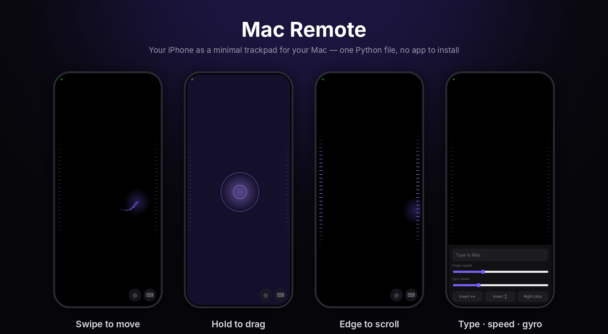

<div align="center">

# Mac Remote

**Your iPhone as a minimal trackpad for your Mac — with an optional gyro air-mouse.**<br>
One Python file. Nothing to install on the phone. No third-party packages on the Mac.

[](LICENSE)




</div>

## Why

Sometimes the keyboard and trackpad are out of reach — you are presenting, watching from the couch, or controlling a Mac
connected to a TV. Existing remote-control apps are heavy, need accounts or installers, or look like 2012.
Mac Remote is a single file you run in Terminal; the phone side is just a web page.

## Features

- **Pure-black, distraction-free trackpad** with soft glow, motion trail and ripple feedback
- **Real gestures** — acceleration-aware cursor, tap, double tap, hold-to-drag, two-finger scroll, two-finger right click
- **One-handed scrolling** — drag along either screen edge, no second finger needed
- **Optional gyro mode** — tilt the phone to move the cursor, scroll and click with your thumb
- **Typing** — a text field that types straight into whatever is focused on the Mac (Backspace and Enter included)
- **Secure by default** — 4-digit PIN, rate limiting, local network only
- **Zero dependencies** — standard-library Python and `openssl`; works on a fresh Mac after installing Command Line Tools
- **Localized** — web UI in English and Ukrainian (follows the phone language)

## Quick start

On the Mac:

```bash
git clone https://github.com/Wombaflow/mac-remote.git
cd mac-remote
python3 mac_remote.py
```

> macOS offers to install the Command Line Tools (which include Python 3) the first time you run `python3`.

1. **Allow control of the Mac.** *System Settings → Privacy & Security → Accessibility* → enable your terminal app
   (Terminal / iTerm), then restart the script.
2. **Open the address on your iPhone** (same Wi-Fi). The script prints it, e.g. `http://192.168.1.20:8080`.
3. **Enter the PIN** printed in the terminal. It is generated once, stored in `~/.mac-remote/pin`, and remembered by the phone.

**Tip:** in Safari tap *Share → Add to Home Screen* for a fullscreen app without browser bars (use the `http://` address).

## Gestures

| Gesture | Action |
| --- | --- |
| One-finger swipe | Move the cursor (a faster swipe travels further) |
| Tap / double tap | Left click / double click |
| Touch and hold ~0.4 s, then move | Drag |
| Two-finger swipe | Scroll |
| Two-finger tap | Right click |
| One finger along the left or right edge | Scroll |
| ⌨︎ button | Text input, finger and gyro speed, axis inversion, right-click button |

## Gyro mode (optional)

Tap **◎** to switch it on or off. iOS exposes motion sensors only on **HTTPS**, so the button takes you to
`https://<mac-ip>:8443`. The server creates a self-signed certificate in `~/.mac-remote/` on first run:

1. Accept Safari's certificate warning once (*Show Details → visit this website*).
2. Enter the PIN again (the HTTPS origin stores it separately).
3. Tap ◎ again and allow **Motion & Orientation Access**.

With gyro on: tilt left/right to move horizontally, tilt away/towards you to move vertically. One finger now scrolls,
a tap clicks, and hold-and-tilt drags. Hold the phone at a natural reading angle (not perfectly vertical).
If an axis feels reversed use **Invert** in the ⌨︎ panel; the gyro speed slider is there too.

## How it works

```
 iPhone (Safari)                            Mac
┌──────────────────┐   WebSocket (LAN)   ┌──────────────────────────────┐
│ touch + tilt     │ ──────────────────▶ │ mac_remote.py                │
│ events, canvas   │   JSON, PIN-checked │  HTTP(S) + WebSocket server  │
│ feedback         │                     │  CoreGraphics via ctypes ──▶ │ cursor, clicks,
└──────────────────┘                     └──────────────────────────────┘ scroll, keys
```

- The server uses only the Python standard library (`http.server`, `ssl`, a small hand-written WebSocket implementation).
- Input is injected with CoreGraphics (`CGEventPost`) through `ctypes`, so no PyObjC or other packages are needed.
- `caffeinate` keeps the Mac awake while the script runs.

## Configuration

| Variable | Default | Meaning |
| --- | --- | --- |
| `PORT` | `8080` | HTTP port |
| `TLS_PORT` | `8443` | HTTPS port (used for gyro mode) |
| `PIN` | stored PIN | Override the PIN for this run |
| `MR_LANG` | auto | Set to `uk` for Ukrainian terminal messages |
| `MOCK` | unset | Log input events instead of injecting them (development, non-macOS) |

`python3 mac_remote.py --version` prints the version.

## Security

- Anyone on your network who knows the PIN can control your Mac. Use it on networks you trust, never on public Wi-Fi.
- The PIN is checked on every connection; after 5 wrong attempts, further attempts are blocked for 60 seconds.
- The `http://` address is not encrypted (the PIN travels in clear text on your LAN). The `https://` address is encrypted but
  uses a self-signed certificate.
- Stop the script (`Ctrl+C`) when you are not using it. See [SECURITY.md](SECURITY.md) to report a vulnerability.

## Troubleshooting

| Symptom | Fix |
| --- | --- |
| Touching the screen does nothing | Accessibility permission is missing — see Quick start, step 1, then restart the script |
| The page does not load | Phone and Mac must be on the same Wi-Fi (guest networks often isolate devices). Wi-Fi is usually `192.168.x.x`; the script lists every IP of the Mac. Type the full `http://…:8080` address |
| The gyro button does nothing | Allow *Settings → Apps → Safari → Motion & Orientation Access*; Safari may ask again after a reload |
| "Wrong PIN" right after a restart | Wait a minute (rate limiting) and retry; the PIN lives in `~/.mac-remote/pin` |
| Cursor goes the wrong way in gyro mode | Use **Invert ↔︎ / ↕︎** in the ⌨︎ panel |

## Roadmap ideas

Contributions welcome — see [CONTRIBUTING.md](CONTRIBUTING.md).

- [ ] QR code in the terminal for one-scan pairing
- [ ] Bonjour/mDNS name (`http://my-mac.local:8080`) instead of an IP address
- [ ] Media and volume keys, Mission Control / app-switch shortcuts
- [ ] Pinch and three-finger gestures
- [ ] Windows and Linux hosts

## License

[MIT](LICENSE)
